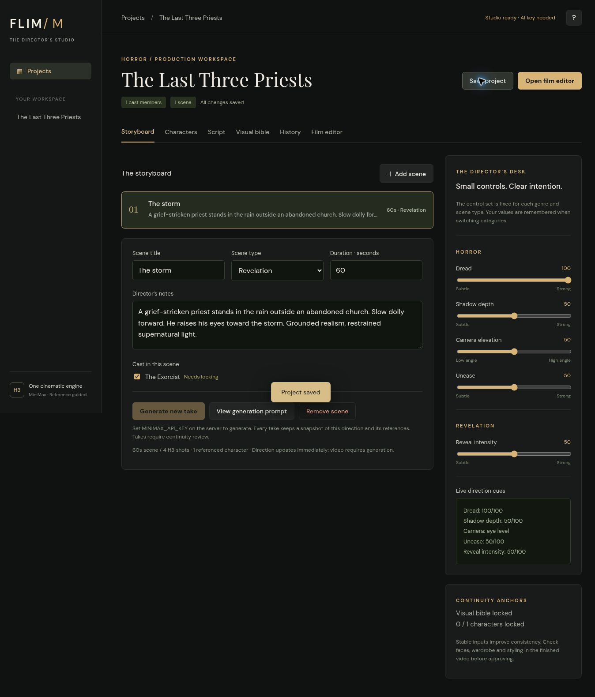

## OpenAI planning + local WAN 2.2 (current backend)

MiniMax is no longer used by the application. OpenAI Platform credits fund **text planning only**. Video generation runs on your own ComfyUI / WAN checkpoint, with no OpenAI video API charge.

1. Start your existing working ComfyUI WAN AIO workflow. Export it as **API format** JSON (not the normal editor workflow JSON). Save it on the GB10, for example `/workspace/flim_M/wan_api.json`.
2. Find the positive text-prompt node ID (its API node must have `inputs.text`). Find the LoadImage node ID if using a start-image reference. Ensure the workflow produces an MP4 in a VideoCombine-style `gifs` or `videos` output.
3. Set these variables in the shell where the studio runs:

```bash
export COMFYUI_URL=http://127.0.0.1:8188
export COMFYUI_WORKFLOW=/workspace/flim_M/wan_api.json
export COMFYUI_PROMPT_NODE=123       # replace with YOUR prompt node ID
export COMFYUI_IMAGE_NODE=52        # replace with YOUR LoadImage node ID
export OPENAI_PLANNING_MODEL=gpt-4.1-mini
read -rsp 'OpenAI API key: ' OPENAI_API_KEY; echo
export OPENAI_API_KEY
python app.py
```

The OpenAI key is optional for **manual storyboards and video generation**; it is required for AI script breakdown and optional multi-shot direction refinement. If unset, the app splits longer scenes into sequential shots with simple deterministic directions.

**Important limitations:** The workflow must be a working API-format ComfyUI graph. The adapter patches only one prompt node and one LoadImage node. It cannot automatically translate the normal editor workflow, assign multiple character references to custom nodes, or guarantee identity consistency. The first locked character reference is uploaded as the start image; additional reference sheets remain available in the prompt's character descriptions. The configured WAN graph controls frame count, resolution, seed and output encoding; the app does not yet automatically change those per shot. For scenes with a final shot shorter than 5 seconds, output is trimmed by FFmpeg. Review all takes before approving. No paid video fallback or automatic retry is performed.

**Security:** Keep ComfyUI and the studio bound to localhost and use SSH forwarding. Never commit API keys or private workflow credentials.

---

# FLIM / M

A local AI filmmaking studio: script → storyboard → reference-guided takes → continuity review → film.

Built around local ComfyUI/WAN video generation, with optional OpenAI API script and shot planning. No model marketplace, node graph or Node installation is required to run the app. Python runs the studio; FFmpeg assembles the footage.



## Run (Linux / GB10)

Install Python 3.11+ and FFmpeg first. On Debian/Ubuntu:

```bash
sudo apt-get update
sudo apt-get install -y python3-venv ffmpeg
```

On Arch/Bedrock's Arch stratum, install `python` and `ffmpeg` using your usual package manager.

From **bash**:

```bash
git clone https://github.com/mackin5150/flim_M.git
cd flim_M
python3 -m venv .venv
source .venv/bin/activate
python -m pip install -r requirements.txt
read -rsp 'MiniMax API key: ' MINIMAX_API_KEY; echo
export MINIMAX_API_KEY
python app.py
```

From **fish**:

```fish
git clone https://github.com/mackin5150/flim_M.git
cd flim_M
python3 -m venv .venv
source .venv/bin/activate.fish
python -m pip install -r requirements.txt
read --silent --prompt-str 'MiniMax API key: ' --export MINIMAX_API_KEY
python app.py
```

Open **http://127.0.0.1:7865**. You can omit the API-key command to explore the studio, save scripts, upload references and build scenes manually. AI planning and video generation need a paid MiniMax API key with access to the configured models. The key stays in the server environment; there is no browser key field. Do not commit it.

For a remote GB10, forward the port from your own computer:

```bash
ssh -L 7865:127.0.0.1:7865 USER@HOST -p SSH_PORT
```

Then open the same localhost URL locally. This is a **single-user local application**, not a public multi-user service. It deliberately binds to loopback and rejects unrecognized Host headers and cross-origin writes. Do not expose it directly with a public tunnel. A public deployment needs authentication, authorization, account isolation and a managed worker/storage layer.

## Make a film

1. **New project:** choose a working title.
2. **Characters:** upload up to three JPEG/PNG/WebP sheets per person. Describe their appearance and exact costume. Save and lock each character. For best results, use front/profile/full-body references with the same wardrobe and a single identity. Every shot supports a total of nine reference images across its assigned cast.
3. **Visual bible:** set the genre and describe the shared palette, texture, lighting principles, camera/lens language and production design. Unlock, save changes and relock when revising it.
4. **Script:** paste your screenplay and choose **Break script into scenes**, or build scenes manually in Storyboard. AI planning replaces the current storyboard; earlier takes stay in History.
5. **Storyboard:** assign cast, write natural-language direction and set scene duration from 4–60 seconds. Genre and scene type each expose a fixed slider schema. Values persist separately for each category; labels cannot be customized. Sliders update the direction cues instantly; they do not modify an already generated video.
6. **Generate new take:** snapshots of the project bible, character references and direction are stored with the take. H3 creates 2K, 16:9 shots with audio. Longer scenes first receive an AI sequential shot breakdown; each shot receives the same canonical references and a specific action beat.
7. **History:** preview the video and its original references. Complete the continuity checklist, approve the take, and add it to the film. Approval is manual, not an automated quality score.
8. **Film editor:** reorder clips, trim in/out points and mute individual clips. Export stitches approved takes into a 1080p, 24 fps H.264/AAC MP4 with hard cuts. Scenes are capped at one minute; the assembled film is not. Native 2K shot files stay on disk and are downloadable from the take's details.

Generation and AI planning use your paid MiniMax account. One minute of scene duration may require four separate paid H3 tasks, plus a text-model shot breakdown. The app never generates automatically when a slider moves. It prevents concurrent duplicate generation for a scene and does not automatically retry ambiguous submissions.

## What is implemented

- Responsive project dashboard and searchable project list.
- SQLite-backed projects, scripts, character sheets and generation/export history.
- Server-enforced wardrobe, appearance, reference and style locks. Unlocking must be saved in a separate revision before protected fields can change.
- Optimistic revision checks to prevent stale saves from overwriting newer work.
- Reference upload validation, EXIF removal, JPEG normalization and bounded image sizes.
- Curated H3 adapter using the current V2 reference-to-video contract.
- AI screenplay and sequential shot breakdown with validated scene/cast IDs.
- Fixed genre/type control presets and persistent values per preset.
- Persistent shot task IDs, a serial worker, restart recovery for pollable tasks and explicit attention states for interrupted submissions.
- Take snapshots and a human continuity approval gate before export.
- Video preview, approved take selection, trimming, reorder, mute, MP4 stitching and downloadable exports.

## Current limits

**Reference consistency is guidance, not a guarantee.** Reusing sheets and wardrobe prompts improves identity stability, but faces, costumes, props and lighting can still drift. Human review is required. There is no automated face-match/wardrobe scoring or automatic regeneration loop yet. H3 shots use the same image references; previous-shot video conditioning and identity embeddings are not implemented.

This is a functional first version, not a full professional NLE. There is no generated storyboard-still pipeline, drag-and-drop multitrack timeline, transitions, music library, voice cloning, subtitles, lip-sync pass, color grading, cloud team accounts or 2K master export yet. Film exports currently normalize to 1080p; original H3 shots remain at the requested 2K resolution. The edit list is stored in browser localStorage per project; exported film jobs retain a server-side copy of the edit decisions.

The worker is intentionally single-process. Run `python app.py`; do not run multiple Uvicorn workers against the same database. Submission is never automatically retried because an interrupted request might already have incurred a charge. A `needs_attention` take retains its saved task IDs: check MiniMax history before generating a replacement. Network/poll failures are shown as failed takes and do not silently submit another video task. Polling tasks resume after restart, but interrupted submissions and FFmpeg assembly are marked for attention. There is no in-app cancellation or failed-job retry yet.

## Data and backup

By default, everything is under `data/` (ignored by Git):

- `studio.sqlite3`: projects and job snapshots.
- `media/`: reference sheets, original generated shots, scene masters and film exports.

Set `FILM_DATA_DIR` to a persistent location **before launching**, especially on Vast:

```fish
set -gx FILM_DATA_DIR /workspace/persistent/flim-m-data
python app.py
```

For bash, use `export FILM_DATA_DIR=/workspace/persistent/flim-m-data`. The directory must be writable. Stop the application before backing up the complete data directory (including any SQLite WAL files). There is no automatic deletion: references used by historical takes remain available. Your MiniMax key is not stored in this directory.

Optional `PORT` changes the localhost port; default is 7865. No `.env` file is loaded automatically.

## Development and validation

```bash
python -m pip install -r requirements.txt
python -m pytest -q
node --check web/app.js  # optional JavaScript syntax check; Node is not needed to run
```

Tests cover every supported scene duration, continuity prompts and locks, reference uploads, SQLite persistence, revision conflicts, origin/host checks, provider payloads, duplicate-job prevention, snapshot retention, worker progression, interrupted-submit recovery and export approval. An actual FFmpeg test creates, trims, mutes and stitches synthetic video, then checks duration and output dimensions. Provider integration tests use mocked responses; live H3 quality and paid-account behavior require a real API key.

## Provider contracts

Verified against official MiniMax documentation on November 19, 2026 (Pacific):

- [H3 task creation](https://platform.minimax.io/docs/api-reference/video-generation-v2-create): `POST /v2/video_generation`, `MiniMax-H3`, reference-image content, 4–15s shots, 2K output.
- [H3 task query](https://platform.minimax.io/docs/api-reference/video-generation-v2-query): `GET /v2/query/video_generation/{task_id}`, nested task status and result URL.
- [Text planning API](https://platform.minimax.io/docs/api-reference/text-openai-api): OpenAI-compatible chat completions using MiniMax M3.1 Flash.

Provider adapters live in `provider.py`; prompt rules and fixed presets live in `core.py`; local API/worker in `app.py`; FFmpeg handling in `media.py`; interface in `web/`.
